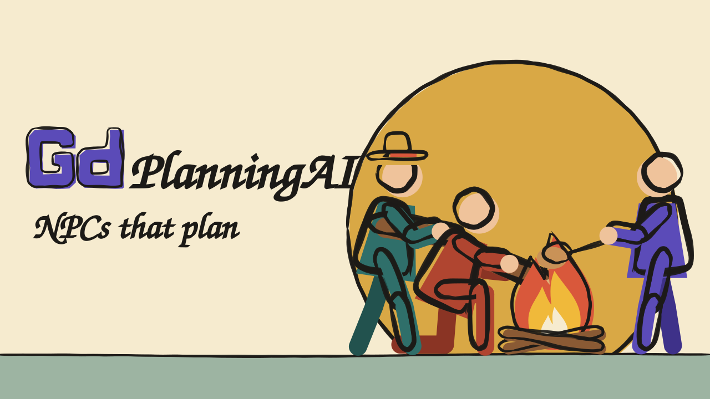

[](https://godotengine.org/asset-library/asset/4156) [](https://store.godotengine.org/asset/wahahayes/gdplanningai/) [](https://codecov.io/gh/WahahaYes/GdPlanningAI) [](https://github.com/WahahaYes/GdPlanningAI/blob/main/LICENSE.txt)

GdPlanningAI (**GdPAI**) is a planning AI addon for Godot 4.2 and newer. Instead of hand-writing state machines or behavior trees, you write goals and actions, and NPCs plan at runtime what to do and in what order. The objects in your world tell NPCs what they can do with them, so new behaviors emerge as you add objects, without hand tuning.

[](https://www.youtube.com/watch?v=ANOevQ_9mPg)

**[Watch the 10-minute intro on YouTube](https://www.youtube.com/watch?v=ANOevQ_9mPg)**: what GdPlanningAI is, NPCs planning in 2D and 3D, and how to use it.

## Why planning


A state machine spells out every switch between states. A behavior tree organises those states into a tree, but every decision is still hand-crafted. Goal Oriented Action Planning (GOAP) works the other way: you write the pieces, goals and the actions that reach them, each with preconditions and effects, and the NPC searches for a chain of actions that reaches its most rewarding goal. Because it searches, it finds combinations nobody wrote down.

GOAP debuted in F.E.A.R. (2005), and planners like it drive the NPCs of Fallout 3, Tomb Raider (2013) and Middle-earth: Shadow of Mordor. GdPlanningAI reimagines GOAP's core and builds the planning around objects in the world.

## The world carries the behavior


Objects carry a `GdPAIObjectData` node listing the actions they offer: a tree offers to be shaken, food to be picked up, a well a drink, but only with a bucket. NPCs plan with whatever is around them, so a new object in the scene is usable right away, with no changes to their behaviors.

## Make your own


You write three kinds of scripts, all in plain GDScript:

- **Goals** say how much an NPC wants something right now (`compute_reward`) and when it's achieved (`get_desired_state`).
- **Actions** have preconditions, an effect the planner simulates, and the code that runs it in your game.
- **Behavior configs** group related goals and actions, and an **agent config** combines them into an NPC type for its `GdPAIAgent` node.

```gdscript
class_name ThirstGoal
extends Goal

# The thirstier the NPC, the more it wants this.
func compute_reward(agent: GdPAIAgent) -> float:
	return agent.blackboard.get_property("thirst")

# Done once thirst is low again.
func get_desired_state(_agent: GdPAIAgent) -> Array[Precondition]:
	return [Precondition.agent_property_less_than("thirst", 10.0)]
```

```gdscript
class_name DrinkAction
extends Action

# Something earlier in the plan has to get water first (the well's DrawWater).
func get_preconditions() -> Array[Precondition]:
	return [Precondition.agent_property_equal_to("has_water", true)]

# What the planner assumes drinking does.
func get_effect_spec() -> Array:
	return [
		{"op": "set", "target": "agent", "prop": "thirst", "value": 0.0},
		{"op": "set", "target": "agent", "prop": "has_water", "value": false},
	]

# What drinking really does: anything your game needs.
func perform_action(agent: GdPAIAgent, _delta: float) -> Action.Status:
	agent.entity.play_animation("drink")  # your character's own code
	agent.blackboard.set_property("thirst", 0.0)
	agent.blackboard.set_property("has_water", false)
	return Action.Status.SUCCESS
```

Actions can call your animations, inventory, stats or signals; the built-in `GoToAction` walks with Godot's navigation. The addon installs a script template for each base class you extend, and [docs/AUTHORING_GUIDE.md](https://github.com/WahahaYes/GdPlanningAI/blob/main/docs/AUTHORING_GUIDE.md) covers every hook and its timing rules.

## How it works


When an NPC needs a plan, its blackboard and the world's are snapshotted and handed to a planner written in Rust, which searches on background threads so the game keeps running. It works backward from the goal to find candidate chains, then verifies them forward by simulating each step on the snapshot, calling back into your scripts for custom costs, effects and preconditions. [docs/ALGORITHM.md](https://github.com/WahahaYes/GdPlanningAI/blob/main/docs/ALGORITHM.md) explains the search in full.

## Installation

Install with one of these, then enable the plugin under **Project > Project Settings > Plugins**:

- **[Godot Asset Store](https://store.godotengine.org/asset/wahahayes/gdplanningai/)** or **[Asset Library](https://godotengine.org/asset-library/asset/4156)**: from the editor.
- **Release zip**: each [release](https://github.com/WahahaYes/GdPlanningAI/releases) attaches `GdPlanningAI-X.Y.Z.zip`, the addon with its library built for Linux, Windows and macOS. GitHub's source archives don't contain the library.
- **From source**: build the library for your platform with Rust installed: `make -C addons/GdPlanningAI/rust build-release` (see [addons/GdPlanningAI/rust/](https://github.com/WahahaYes/GdPlanningAI/blob/main/addons/GdPlanningAI/rust)). The addon warns at startup if the library's version differs from `plugin.cfg`.

## Examples

Open a scene in `examples/` and press **Run Current Scene** (F6). [docs/EXAMPLES.md](https://github.com/WahahaYes/GdPlanningAI/blob/main/docs/EXAMPLES.md) says what each shows and which scripts to read.

- **`hunger_basic_2d`**: one NPC wanders, then shakes a tree and eats when hungry. Start here.
- **`hunger_multi_agent_2d`** and **`hunger_stress_test_2d`**: several NPCs sharing trees, and a configurable crowd for performance.
- **`campfire_2d`**, **`campfire_3d`** and **`campfire_large_3d`**: NPCs keep fires fuelled and cook potatoes on them, juggling two goals that depend on each other.
- **`agent_showcase_3d`**: character skins, animations and carried items, with planning off.

## Documentation

The docs live in this repository; the addon install copies only the addon and its templates.

| Doc                                                                                                                 | What it covers                                                       |
| ------------------------------------------------------------------------------------------------------------------- | -------------------------------------------------------------------- |
| [AUTHORING_GUIDE.md](https://github.com/WahahaYes/GdPlanningAI/blob/main/docs/AUTHORING_GUIDE.md)                   | Writing goals, actions, preconditions and world objects.             |
| [EXAMPLES.md](https://github.com/WahahaYes/GdPlanningAI/blob/main/docs/EXAMPLES.md)                                 | What each example scene shows and which scripts to read.             |
| [ALGORITHM.md](https://github.com/WahahaYes/GdPlanningAI/blob/main/docs/ALGORITHM.md)                               | How the planner finds a plan, with pseudocode of the engine.         |
| [CODEBASE_OVERVIEW.md](https://github.com/WahahaYes/GdPlanningAI/blob/main/docs/CODEBASE_OVERVIEW.md)               | Where things live, how Rust and GDScript talk, building, testing.    |
| [ARCHITECTURE.md](https://github.com/WahahaYes/GdPlanningAI/blob/main/docs/ARCHITECTURE.md)                         | Class diagrams of the addon.                                         |
| [BEHAVIORS.md](https://github.com/WahahaYes/GdPlanningAI/blob/main/docs/BEHAVIORS.md)                               | What the addon promises, each behavior with the tests that prove it. |
| [DOCUMENTATION_GUIDELINES.md](https://github.com/WahahaYes/GdPlanningAI/blob/main/docs/DOCUMENTATION_GUIDELINES.md) | Comment and docstring style for contributors.                        |

## License

GdPlanningAI, Copyright 2025 Ethan Wilson. Licensed under the Apache License, Version 2.0: see [LICENSE.txt](https://github.com/WahahaYes/GdPlanningAI/blob/main/LICENSE.txt).

The example scenes use [Tiny Swords](https://pixelfrog-assets.itch.io/tiny-swords) by Pixel Frog (2D), KayKit Adventurers, Resource Bits and Medieval Hexagon Pack by Kay Lousberg (3D, CC0, [kaylousberg.com](https://www.kaylousberg.com)) and the MedievalSharp font (SIL OFL 1.1); their licences are in `examples/licenses/`. The README's art uses the Caveat font (SIL OFL 1.1), embedded in each image.
