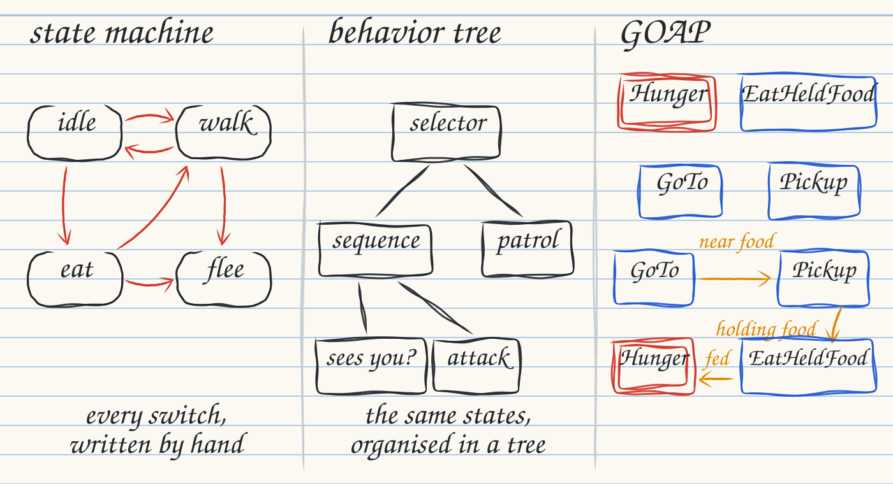
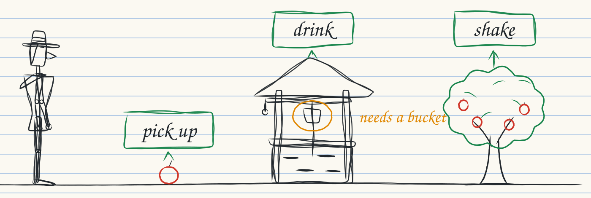
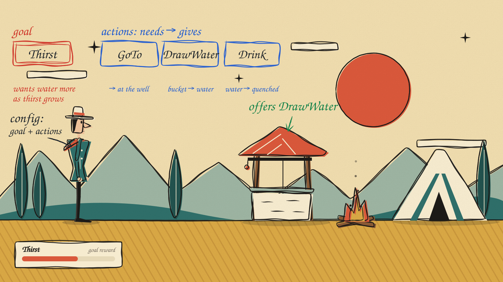

# GdPlanningAI

[](https://godotengine.org/asset-library/asset/4156) [](https://store.godotengine.org/asset/wahahayes/gdplanningai/) [](https://codecov.io/gh/WahahaYes/GdPlanningAI) [](https://github.com/WahahaYes/GdPlanningAI/blob/main/LICENSE.txt)

GdPlanningAI (**GdPAI**) is a planning AI addon for Godot (tested 4.2 and newer). Instead of hand-writing state machines or behavior trees, a suite of goals, actions, and the rules around them are defined. NPCs then plan at runtime and decide what actions to take, driven by the situations around them. The objects in your world tell NPCs what they can do with them, so new, emergent behaviors come up as new features and objects are added, without hand tuning.

1. [Why planning](#why-planning)
1. [The world carries the behavior](#the-world-carries-the-behavior)
1. [Make your own](#make-your-own)
1. [How it works](#how-it-works)
1. [Installation](#installation)
1. [Examples](#examples)
1. [Documentation](#documentation)
1. [License](#license)

## Why planning



A state machine spells out every switch between states. A behavior tree organises those states into a tree, but still requires developers to hand-craft every decision. Goal Oriented Action Planning (GOAP) uses the opposite principle. The developers write the pieces (goals for NPCs and actions they can take), each with preconditions and effects, and the NPC searches for a chain of actions that reaches its most rewarding goal. Because it searches, it finds combinations that were never explicitly written down.

GOAP comes from Jeff Orkin's AI for F.E.A.R. (2005), and planners like it have driven the NPCs in Fallout 3, Tomb Raider (2013), Middle-earth: Shadow of Mordor, and many more. GdPlanningAI is a fresh reimagining of GOAP's core and builds out the planning around objects in the world.

## The world carries the behavior



Objects in the scene carry a `GdPAIObjectData` node that lists the actions they offer. A tree offers to be shaken, food offers to be picked up, a well offers a drink, but only if you have a bucket. NPCs plan with whatever is around them, so they don't need to know about every object in the game. Drop a new object into a scene and NPCs can use it right away, with no changes to their behaviors.

While planning, an NPC works on snapshots of its own and the world's state, planning in offloaded background threads, enabling them to try actions out without touching the live scene.

## Make your own



Developers incorporating GdPlanningAI only need to write three kinds of scripts, all in plain GDScript:

- **Goals** say how much an NPC wants something right now (`compute_reward`) and when it's achieved (`get_desired_state`).
- **Actions** have preconditions, an effect the planner simulates, and the code that executes or calls out to game logic.
- **Behavior configs** group related goals and actions, and an **agent config** combines them into an NPC type that its `GdPAIAgent` node uses.

```gdscript
class_name ThirstGoal
extends Goal

# The thirstier the NPC, the more it wants this.
func compute_reward(agent: GdPAIAgent) -> float:
	return agent.blackboard.get_property("thirst")

# Done once thirst is low again.
func get_desired_state(_agent: GdPAIAgent) -> Array[Precondition]:
	return [Precondition.agent_property_less_than("thirst", 10.0)]
```

```gdscript
class_name DrinkAction
extends Action

# Something earlier in the plan has to get water first (the well's DrawWater).
func get_preconditions() -> Array[Precondition]:
	return [Precondition.agent_property_equal_to("has_water", true)]

# What the planner assumes drinking does.
func get_effect_spec() -> Array:
	return [
		{"op": "set", "target": "agent", "prop": "thirst", "value": 0.0},
		{"op": "set", "target": "agent", "prop": "has_water", "value": false},
	]

# What drinking really does: anything your game needs.
func perform_action(agent: GdPAIAgent, _delta: float) -> Action.Status:
	agent.entity.play_animation("drink")  # your character's own code
	agent.blackboard.set_property("thirst", 0.0)
	agent.blackboard.set_property("has_water", false)
	return Action.Status.SUCCESS
```

The planner is a core algorithm that decides what to do next, but your game decides what logic actually gets executed. Actions can call your animations, inventory, stats or signals. The `script_templates/` folder (installed with the addon) has a template for each class, and [docs/AUTHORING_GUIDE.md](https://github.com/WahahaYes/GdPlanningAI/blob/main/docs/AUTHORING_GUIDE.md) covers every hook and its timing rules. The built-in `GoToAction` handles walking using Godot's built-in navigation.

## How it works


Your NPCs, goals and actions live in GDScript. Each NPC and the world keep a blackboard of properties; when an NPC needs a plan, both are snapshotted and the job goes to a scheduler. A planner written in Rust searches on background threads, so the game keeps running while NPCs think.

The search runs in two passes. It first works backward from the goal, matching what each step needs to what earlier actions provide. It then checks candidate plans forward, simulating every step on the snapshot. Along the way it calls back into your scripts for anything custom, such as computing an action's cost, its effect, or a custom precondition. Planning is spread across frames in time slices, and an NPC whose plan failed backs off before trying again. [docs/ALGORITHM.md](https://github.com/WahahaYes/GdPlanningAI/blob/main/docs/ALGORITHM.md) explains the search in full.

## Installation

GdPlanningAI needs Godot 4.2 or newer. Installation copies `addons/GdPlanningAI` and `script_templates` into your project. Enable the plugin under **Project > Project Settings > Plugins**.

If installing from source rather than a release bundle, the rust binaries must be built for your OS or copied from the latest release. See [addons/GdPlanningAI/rust/](https://github.com/WahahaYes/GdPlanningAI/blob/main/addons/GdPlanningAI/rust).

- **[Godot Asset Store](https://store.godotengine.org/asset/wahahayes/gdplanningai/)** or **[Asset Library](https://godotengine.org/asset-library/asset/4156)**: install from the editor.
- **Release zip**: each [release](https://github.com/WahahaYes/GdPlanningAI/releases) attaches `GdPlanningAI-X.Y.Z.zip`, the addon with its library built for Linux, Windows and macOS. GitHub's own source archives don't contain the library, so use the zip.
- **From source**: the library isn't committed, so build it for your platform: install Rust (the version is pinned in `addons/GdPlanningAI/rust/rust-toolchain.toml`) and run `make -C addons/GdPlanningAI/rust build-release`. Rebuild after pulling Rust changes; the addon warns at startup when the library's version differs from `plugin.cfg`.

## Examples

The `examples/` folder in this repository has scenes you can run: open one and press **Run Current Scene** (F6). [docs/EXAMPLES.md](https://github.com/WahahaYes/GdPlanningAI/blob/main/docs/EXAMPLES.md) says what each one shows and which scripts to read.

- **`hunger_basic_2d`**: one NPC that wanders, and shakes a tree and eats when it gets hungry. Start here.
- **`hunger_multi_agent_2d`**: several NPCs sharing the same trees.
- **`hunger_stress_test_2d`**: the same with a configurable NPC count, for performance.
- **`campfire_2d`** and **`campfire_3d`**: NPCs keep a fire fuelled with wood and cook potatoes on it, juggling two goals that depend on each other.
- **`campfire_large_3d`**: six NPCs in a larger scene, each pair tending its own fire.
- **`agent_showcase_3d`**: character skins, animations and carried items, with planning off.

## Documentation

The docs live in this repository; installing the addon copies only the addon and its templates.

| Doc                                                                                                                 | What it covers                                                       |
| ------------------------------------------------------------------------------------------------------------------- | -------------------------------------------------------------------- |
| [AUTHORING_GUIDE.md](https://github.com/WahahaYes/GdPlanningAI/blob/main/docs/AUTHORING_GUIDE.md)                   | Writing goals, actions, preconditions and world objects.             |
| [EXAMPLES.md](https://github.com/WahahaYes/GdPlanningAI/blob/main/docs/EXAMPLES.md)                                 | What each example scene shows and which scripts to read.             |
| [ALGORITHM.md](https://github.com/WahahaYes/GdPlanningAI/blob/main/docs/ALGORITHM.md)                               | How the planner finds a plan.                                        |
| [PLANNER_PSEUDOCODE.md](https://github.com/WahahaYes/GdPlanningAI/blob/main/docs/PLANNER_PSEUDOCODE.md)             | Pseudocode of the planner, for working on the Rust engine.           |
| [CODEBASE_OVERVIEW.md](https://github.com/WahahaYes/GdPlanningAI/blob/main/docs/CODEBASE_OVERVIEW.md)               | Where things live, how Rust and GDScript talk, building, testing.    |
| [BEHAVIORS.md](https://github.com/WahahaYes/GdPlanningAI/blob/main/docs/BEHAVIORS.md)                               | What the addon promises, each behavior with the tests that prove it. |
| [DOCUMENTATION_GUIDELINES.md](https://github.com/WahahaYes/GdPlanningAI/blob/main/docs/DOCUMENTATION_GUIDELINES.md) | Comment and docstring style for contributors.                        |

## License

GdPlanningAI, Copyright 2025 Ethan Wilson

Licensed under the Apache License, Version 2.0: see [LICENSE.txt](https://github.com/WahahaYes/GdPlanningAI/blob/main/LICENSE.txt) or [http://www.apache.org/licenses/LICENSE-2.0](http://www.apache.org/licenses/LICENSE-2.0).

**Example assets.** The example scenes use these packs; their licences are in `examples/licenses/`.

- 2D scenes: [Tiny Swords](https://pixelfrog-assets.itch.io/tiny-swords) by Pixel Frog.
- 3D characters and animations: KayKit Adventurers by Kay Lousberg ([kaylousberg.com](https://www.kaylousberg.com)), CC0.
- 3D props: KayKit Resource Bits and KayKit Medieval Hexagon Pack by Kay Lousberg ([kaylousberg.com](https://www.kaylousberg.com)), CC0.
- Label font: MedievalSharp, SIL Open Font License 1.1.

The README's illustrations use the Caveat font (SIL Open Font License 1.1), embedded in each image.
