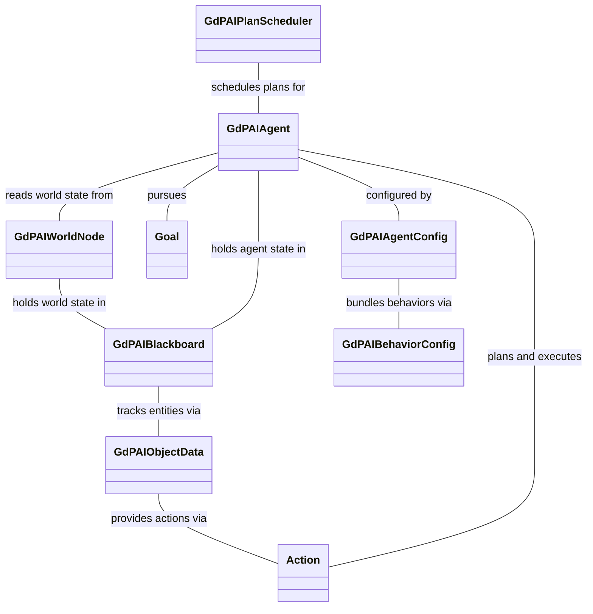
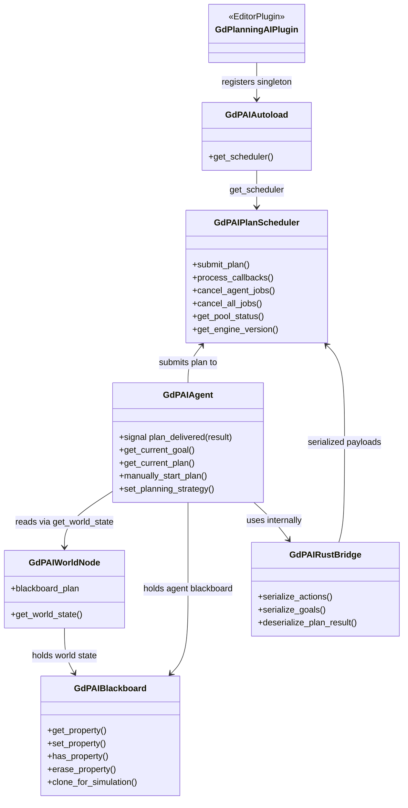
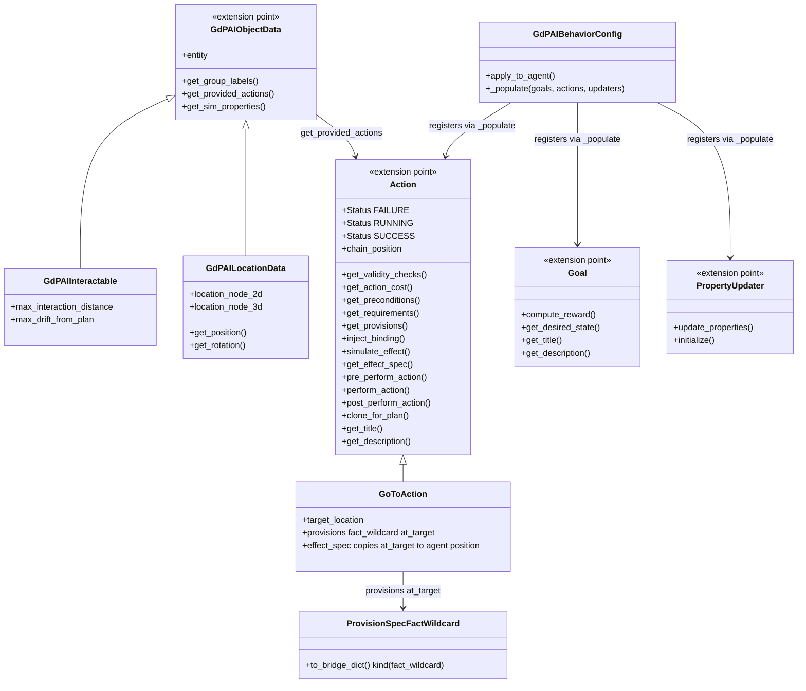

# Architecture

The diagrams below are generated from `docs/generated/*.mmd` and embedded here. For exact method signatures, params, and return types see [api-spec.json](generated/api-spec.json); the diagrams show shortened names for readability.

## Overview — [architecture-overview.mmd](generated/architecture-overview.mmd)

Shows the main classes and how they relate, without methods. Use it to see which subsystem owns what before reading the detailed diagrams.

## Runtime — [architecture-runtime.mmd](generated/architecture-runtime.mmd)

Shows the planning loop: how Agent, Scheduler, WorldNode, Blackboard, and the Rust bridge connect, with key methods only. Use it when tracing a live plan; see [api-spec.json](generated/api-spec.json) for full signatures.

## Authoring — [architecture-authoring.mmd](generated/architecture-authoring.mmd)

Shows the content classes (ObjectData, Action, Goal, PropertyUpdater) and how BehaviorConfig wires them to an agent. Use it when writing game content; classes marked \<<extension point>> are meant to be subclassed.

## Specs — [architecture-specs.mmd](generated/architecture-specs.mmd)

Shows the Precondition, RequirementSpec, and ProvisionSpec hierarchies and what each to_bridge_dict sends across the Rust bridge. Use it when declaring planner constraints; see [api-spec.json](generated/api-spec.json) for exact bridge string shapes.

```mermaid
classDiagram
    Precondition <|-- PreconditionBuiltin
    Precondition <|-- PreconditionCustom
    PreconditionCustom <|-- PreconditionCustomWithDeps
    RequirementSpec <|-- RequirementSpecBindingExists
    RequirementSpec <|-- RequirementSpecBindingEquals
    RequirementSpec <|-- RequirementSpecBindingInSet
    RequirementSpec <|-- RequirementSpecFact
    ProvisionSpec <|-- ProvisionSpecBinding
    ProvisionSpec <|-- ProvisionSpecFact
    ProvisionSpec <|-- ProvisionSpecFactWildcard
    Action --> Precondition : get_preconditions
    Action --> RequirementSpec : get_requirements
    Action --> ProvisionSpec : get_provisions
    GoToAction --> ProvisionSpecFactWildcard : provisions at_target

    class Precondition {
        <<extension point>>
        +to_bridge_dict()
    }
    class PreconditionBuiltin {
        +Target AGENT
        +Target WORLD_STATE
        +Target WORLD_OBJECT_PROXY
        +Op HAS_PROPERTY
        +Op EQUAL
        +Op NOT_EQUAL
        +Op GT
        +Op GTE
        +Op LT
        +Op LTE
        +to_bridge_dict() kind (builtin)
    }
    class PreconditionCustom {
        +eval_func
        +to_bridge_dict() kind (custom)
    }
    class PreconditionCustomWithDeps {
        +dependent_objects
        +to_bridge_dict() kind (custom_with_deps)
    }
    class RequirementSpec {
        <<extension point>>
        +binding_exists(fact)
        +binding_equals(fact, value)
        +binding_in_set(fact, values)
        +fact(fact, values)
        +to_bridge_dict()
    }
    class RequirementSpecBindingExists {
        +to_bridge_dict() kind (binding_exists)
    }
    class RequirementSpecBindingEquals {
        +to_bridge_dict() kind (binding_equals)
    }
    class RequirementSpecBindingInSet {
        +to_bridge_dict() kind (binding_in_set)
    }
    class RequirementSpecFact {
        +to_bridge_dict() kind (fact)
    }
    class ProvisionSpec {
        <<extension point>>
        +binding(fact, value)
        +fact(fact, values)
        +fact_wildcard(fact)
        +to_bridge_dict()
    }
    class ProvisionSpecBinding {
        +to_bridge_dict() kind (binding)
    }
    class ProvisionSpecFact {
        +to_bridge_dict() kind (fact)
    }
    class ProvisionSpecFactWildcard {
        +to_bridge_dict() kind (fact_wildcard)
    }
    class Action {
        +get_preconditions()
        +get_requirements()
        +get_provisions()
    }
    class GoToAction {
        +get_provisions()
        +get_effect_spec()
    }

    note for RequirementSpecBindingExists "to_bridge_dict() kind (binding_exists) with (fact)"
    note for RequirementSpecBindingEquals "to_bridge_dict() kind (binding_equals) with (fact) (value)"
    note for RequirementSpecBindingInSet "to_bridge_dict() kind (binding_in_set) with (fact) (values)"
    note for RequirementSpecFact "to_bridge_dict() kind (fact) with (fact) (values)"
    note for ProvisionSpecBinding "to_bridge_dict() kind (binding) with (fact) (value)"
    note for ProvisionSpecFact "to_bridge_dict() kind (fact) with (fact) (values)"
    note for ProvisionSpecFactWildcard "to_bridge_dict() kind (fact_wildcard) with (fact) used by GoToAction for at_target"
    note for PreconditionBuiltin "to_bridge_dict() kind (builtin) with (target) (op) (value)"
    note for PreconditionCustom "to_bridge_dict() kind (custom) with eval_func as callable string"
```

